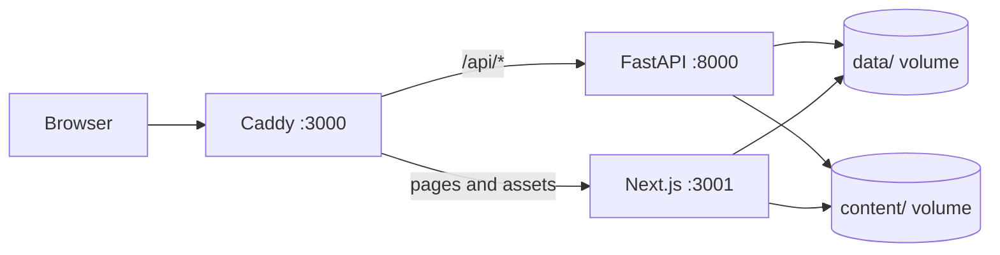

<p align="center">
  
</p>

<h1 align="center">Personal Site</h1>

<p align="center">
  A bilingual personal site, blog, and site-native agent.<br />
  One repository, one container.
</p>

<p align="center">
  <a href="https://nextjs.org"></a>
  <a href="https://www.typescriptlang.org"></a>
  <a href="https://tailwindcss.com"></a>
  <a href="https://fastapi.tiangolo.com"></a>
  <a href="https://www.docker.com"></a>
  <a href="./LICENSE"></a>
</p>

## Overview

Personal Site is a self-hosted portfolio and blog for developers who want to own the full stack. It pairs a dark, editorial frontend with a Python API, file-based content, and an agent that answers from the site's own material.

There is no database and no external CMS. Profile data, projects, posts, and runtime settings live as JSON and MDX, with a single Docker container for deployment.

## Features

- **Bilingual by default** — Chinese and English share one content model. Sections are real routes such as `/zh/projects` and `/en/about`, not hash links.
- **Agent grounded in the site** — Answers are retrieved from the profile, projects, experience, and posts, with citations. Open it with the `AGENT` control or `⌘J`; local retrieval works without a key, and an OpenAI-compatible LLM is optional.
- **Terminal with real data** — Press `~` or `⌘K` to open a shell for navigation, view counts, theme, and language. It reads the same content as the rest of the site.
- **Write in MDX** — Posts support frontmatter, tags, reading time, code highlighting, and optional giscus comments. The `/admin` panel edits the profile and mail settings without a database; posts stay file-based.
- **No database to operate** — `content/` and `data/` are the source of truth. Backups are plain files.
- **One container, one port** — Caddy serves the public entry point, routes `/api/*` to FastAPI, and sends everything else to Next.js.

## Architecture



The image runs all three processes in one container. `site-data` stores the profile, mail configuration, and view counts; `site-content` stores posts. Both are mounted as volumes in Docker.

## Quick Start

### Docker

```bash
git clone https://github.com/shi-YangYang/personal-site.git
cd personal-site

cp .env.example .env
# Set ADMIN_PASSWORD and ADMIN_SESSION_SALT before production use.

docker compose up -d --build
```

Open [http://localhost:3000/zh](http://localhost:3000/zh). The site runs with placeholder content until you fill in your own profile through `/admin` or `data/personal.local.json`.

### Local development

Requires Node.js 20.9+, Python 3.9+, and pnpm.

```bash
pnpm install

python3 -m venv backend/.venv
backend/.venv/bin/pip install -r backend/requirements.txt

pnpm dev
```

`pnpm dev` starts FastAPI and Next.js together, chooses an available API port, and injects `NEXT_PUBLIC_API_BASE_URL`. Open [http://localhost:3000/zh](http://localhost:3000/zh).

## Configuration

Start from [`.env.example`](./.env.example). The most important variables:

| Variable | Purpose |
| --- | --- |
| `ADMIN_PASSWORD` | Enables `/admin`. Leave unset to keep the admin panel disabled. |
| `ADMIN_SESSION_SALT` | Shared session salt; must match between Next.js and FastAPI. |
| `COOKIE_SECURE` | Set to `true` when serving over HTTPS. |
| `NEXT_PUBLIC_SITE_URL` | Canonical URL used for metadata and the sitemap. |
| `AGENT_LLM_BASE_URL`, `AGENT_LLM_API_KEY`, `AGENT_MODEL` | Optional OpenAI-compatible model for the agent. Without them, local retrieval is used. |
| `SMTP_*` | Optional contact-form email notifications. |

## Privacy

The repository ships with placeholder content. Real profile data, mail credentials, view counts, and local drafts stay out of Git:

```text
data/personal.local.json
data/mail.json
data/views.json
content/blog/**/_local/
content/blog/**/_drafts/
```

Only the placeholder files in `content/data/` and the sample posts are committed. The site is safe to fork and customize without publishing personal information.

## Project structure

```text
app/[lang]/          Bilingual pages and section routes
app/admin/           Cookie-gated admin panel
backend/             FastAPI: agent, contact, views, admin API
components/          UI, sections, terminal, agent console
content/             Placeholder profile data and MDX posts
data/                Runtime data (gitignored)
lib/                 Content loading, blog parsing, API client
Caddyfile            Public entry point
Dockerfile           Caddy + Next.js + FastAPI image
docker-compose.yml   Volumes, healthcheck, runtime configuration
```

The agent implementation is documented in the [spec](specs/spec-002-cyber-agent/spec.md) and [acceptance record](specs/spec-002-cyber-agent/acceptance.md).

## Deployment

Docker Compose is the supported deployment path:

```bash
docker compose up -d --build
```

Only port `3000` is exposed. Keep the `site-data` and `site-content` volumes; do not run `docker compose down -v`.

Deployments are manual through **Actions → Deploy → Run workflow**. The workflow backs up both volumes before rebuilding. Pull requests run CI for web lint/build, backend import/compile, and a Docker image build.

## Contributing

Pull requests target `dev`. Keep changes focused, and open an issue before larger changes. CI runs on every PR targeting `dev` or `main`.

## License

[MIT](./LICENSE) © 2026 · Maintained by [@shi-YangYang](https://github.com/shi-YangYang)
